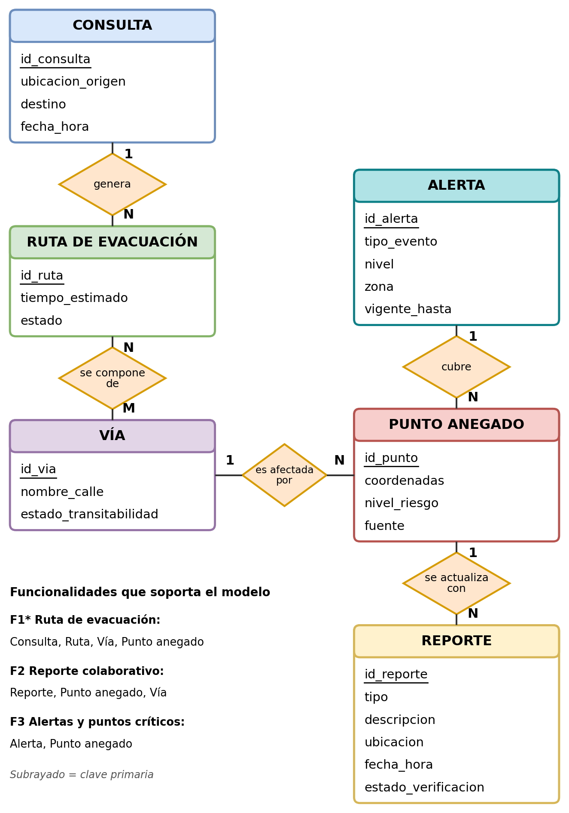
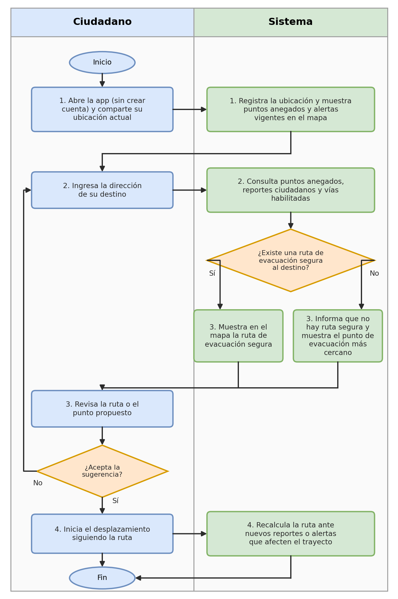
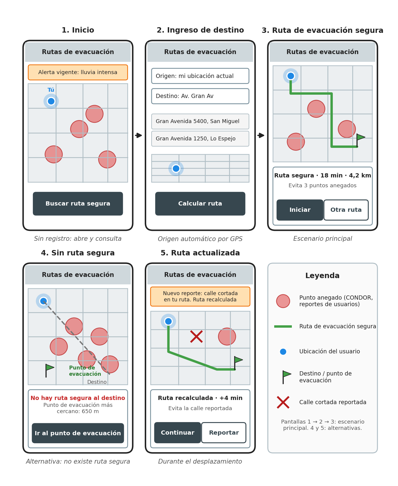

# Contexto académico del proyecto

Resumen de los entregables I, II, la matriz de riesgos y el III. Los originales están en `.claude/context-docs/`.

## Equipo y ámbito

- **Equipo 13 "1101" (P207):** Juan Yañez, Vicente Zapata, Cristóbal Vargas, Gonzalo Vega y Yusu Zhan.
- **Ámbito:** Desastres de origen natural.
- **Proyecto:** Dry Routes.

## Problema (E2, actualizado)

Las personas que viven o se desplazan por ciudades de Chile expuestas a lluvias intensas y sistemas frontales no saben qué calles, pasos bajo nivel o puentes siguen transitables, ni por dónde evacuar cuando ocurren anegamientos y crecidas. Esto provoca desplazamientos inseguros, vehículos atrapados y comunidades aisladas.

- **Evidencia:** el Gobierno de Santiago, con la plataforma CONDOR, identificó 175 puntos críticos de muy alto riesgo en la RM. El MOP registra más de 1.300 puntos de afectación vial en eventos frontales. El sistema frontal de septiembre de 2026 dejó 12.303 personas aisladas y provocó el colapso del Puente Viejo de Lautaro.
- **Brecha:** Waze depende de reportes voluntarios y no valida rutas de evacuación. Las alertas de SENAPRED son por comuna o región y no guían el desplazamiento.

## Historias de usuario (E2)

1. **(Corazón)** Como ciudadano afectado por una inundación o colapso vial, quiero ingresar mi ubicación actual y mi destino para ver en un mapa interactivo una ruta de evacuación que evite zonas anegadas y vías cortadas, para desplazarme con seguridad.
2. Como usuario en la vía pública, quiero reportar de forma sencilla calles anegadas, árboles caídos o puentes y caminos cortados, para que el mapa y las rutas se actualicen.
3. Como usuario en zona de riesgo, quiero ver las alertas vigentes y los puntos críticos de mi zona en el mapa, para anticiparme a desvíos.
4. Como usuario en emergencia, quiero acceder al mapa de rutas sin crear cuenta, para consultar vías de evacuación sin fricción.

## Funcionalidades

| # | Funcionalidad | HdU | Estado del plan |
|---|---|---|---|
| 1* | **Ruta de evacuación segura.** Origen y destino → ruta que evita puntos anegados; si no existe, el punto de evacuación más cercano. Sin registro. | 1, 4 | **Entregable III (30 oct)** |
| 2 | Reporte colaborativo de anegamientos, calles cortadas, árboles o puentes; afecta las rutas. | 2 | Después del E3 |
| 3 | Alertas vigentes y puntos críticos en el mapa, con su nivel de riesgo. | 3 | Después del E3 (fuente: MeteoPrecisa / SENAPRED) |

Para la entrega final se exige la funcionalidad corazón más **una segunda funcionalidad priorizada**, con persistencia, conexión a una API pública u otra característica aprobada.

## Modelo entidad-relación (E2)

Entidades: Consulta, Ruta de evacuación, Vía, Punto anegado, Reporte y Alerta.
**Implementación en la v1 (simplificación consciente):**

- `PuntoAnegado` → modelo Django (campos: `nombre`, `tipo`, `lat`, `lon`, `activo`, `fuente`, `osm_id`).
- `PuntoEvacuacion` → modelo Django nuevo. No estaba en el ER, pero lo exige el caso "sin ruta segura".
- `Vía` → son las aristas del grafo en `data/grafo.json`; no se guardan en la base de datos.
- `Consulta` y `Ruta` → se calculan en cada petición y no se guardan. El E3 no exige persistencia; se pueden agregar después.
- `Reporte` y `Alerta` → corresponden a F2 y F3, después del viernes.

Esta diferencia con el E2 hay que explicarla en el documento del E3 ("cambios respecto al Entregable II").

## Flujo de la funcionalidad corazón (E2)

## Prototipo (E2)

## Matriz de riesgos (resumen)

| ID | Riesgo | P×I | Respuesta | Resp. |
|---|---|---|---|---|
| R1 | Alcance mayor que la capacidad: no llegar con la funcionalidad corazón | 9 | **Evitar:** v1 solo con la ruta segura; F2 y F3 diferidas | Juan |
| R2 | Conocimiento de Django concentrado en una persona | 6 | Sesión de traspaso de 1 h, tutorial oficial antes del 2/11, trabajo en parejas | Juan |
| R3 | El algoritmo de ruta no funciona o es lento | 6 | NetworkX y una sola zona primero | Gonzalo → **ahora Juan y Vicente** (cambio de roles) |
| R4 | Problemas de integración o conflictos de Git | 6 | Integración frecuente en main, ramas y revisión de PR | Yusu |
| R5 | La ruta pasa por una vía anegada sin que lo detectemos | 6 | Escenarios simulados en los pasos bajo nivel de Gran Avenida, Lo Espejo y Departamental, prueba con 5 usuarios, aviso "ruta referencial" | Vicente |
| R6 | CONDOR no es descargable | 4 | ~~CSV manual~~ → **extracción automática desde OSM** (DECISIONES D4) | Cristóbal |
| R7 | Carga de otros ramos | 4 | Tablero de GitHub, reunión semanal de 15 min, respaldo por tarea | Gonzalo |
| R8 | El mapa de OSM falla en la demo | 2 | Aceptar: video grabado de respaldo | Yusu |
